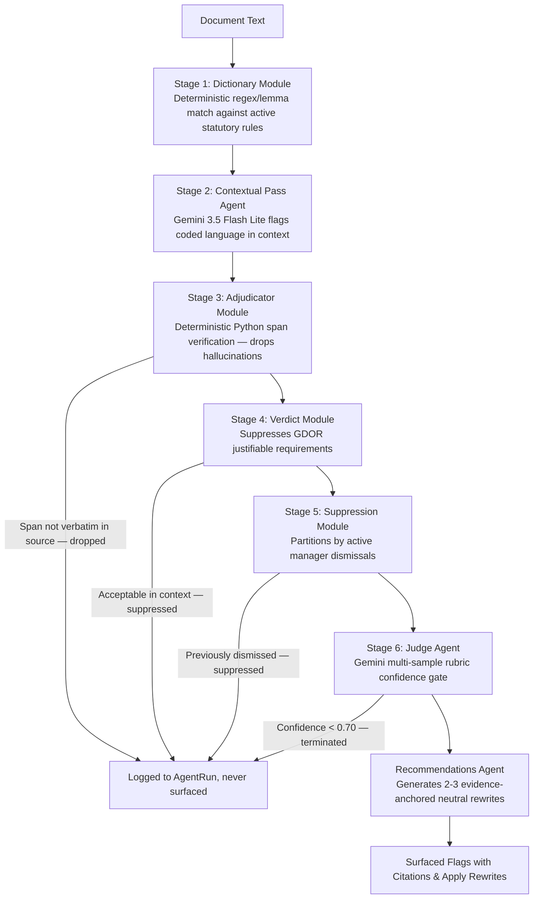
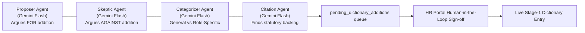

# Pattern Specular

A longitudinal bias-pattern analysis system for hiring managers: real-time deterministic and agentic bias flagging in hiring and promotion writing, criteria drift evaluation, and statistically-gated pattern surfacing powered by Google Gemini and Neon Serverless PostgreSQL.


[](LICENSE)

---

## Provenance & Attribution

Pattern Specular is an architectural adaptation of **[Pattern Mirror](https://github.com/Bernice-Koh/pattern-mirror)** originally created by **Bernice Koh** for the UBS Tomorrow's Talent Programme 2026 under the MIT License.

### Key Architectural Extensions in Pattern Specular:
1. **Model Layer Migration:** Re-engineered the agentic pipeline from Anthropic Claude to **Google Gemini (Gemini 3.5 Flash Lite)** using `instructor.from_genai` with normalized token accounting and strict-coercion handling ([ADR 0014](docs/adr/0014-google-gemini-over-anthropic-claude.md)).
2. **Cloud Infrastructure:** Migrated from local Docker PostgreSQL to cloud-native **Neon Serverless PostgreSQL** with pooled connections.
3. **Multi-Region Jurisdictions:** Expanded statutory coverage from Singapore (TAFEP) to include **India Labor Law** (Code on Wages 2019, RPwD Act 2016, Transgender Persons Act 2019) ([ADR 0015](docs/adr/0015-multi-region-statutory-expansion-india.md)).

---

## The Problem

Unconscious bias persists in recruitment and performance evaluations despite widespread unconscious bias training. Managers know the theory, yet coded language, gendered framing, and shifting evaluation criteria frequently slip into job descriptions, interview feedback, and promotion writeups. 

Because these tendencies only become visible when looking across a manager's entire corpus of writing over time, traditional spelling and grammar tools miss them entirely.

**Pattern Specular** surfaces these patterns in a manager's own writing with cited statutory and academic evidence—never as a hiring gate or punitive score. Whether to revise remains entirely in the manager's control.

---

## System Architecture

The core of Pattern Specular is a bounded 6-stage **LangGraph StateGraph** pipeline:



### Self-Growing Lexicon (4-Agent Debate Loop)



---

## Product Surfaces

### Manager Portal
- **JD Studio:** Real-time dual-layer writing surface. Layer 1 provides instant deterministic highlights; Layer 2 streams contextual bias flags and recommended rewrites via Server-Sent Events (SSE) after a typing pause.
- **Feedback Checkpoint:** Pre-submission evaluation of interview feedback against original job description criteria to detect criteria drift.
- **Promotion Writeup:** Validates promotion cases against historical peer feedback.
- **Pattern Dashboard:** Longitudinal view displaying writing patterns only when **Fisher's Exact Test** confirms statistical significance ($p < 0.05$).

### HR Portal
- **Trends Dashboard:** Firm-wide aggregated analytics with strict $k \ge 3$ suppression to prevent individual identification.
- **Dictionary Review:** Human-in-the-loop review queue for candidate bias terms surfaced by the 4-agent debate loop.

---

## Tech Stack

| Layer | Technologies |
|---|---|
| **Frontend** | React 19, TypeScript, Vite, Tailwind CSS v4, TipTap (ProseMirror), TanStack Router & Query |
| **Backend** | Python 3.12+, FastAPI, Uvicorn, LangGraph, Pydantic Settings, Structlog |
| **AI / Agentic** | Google Gemini (3.5 Flash Lite), Instructor for schema enforcement |
| **Database** | Neon Cloud Serverless PostgreSQL 16, SQLAlchemy 2.0, Alembic |
| **NLP & Stats** | spaCy (`en_core_web_sm`), scipy (`scipy.stats.fisher_exact`) |

---

## Getting Started

### Prerequisites
- Python 3.12+
- Node.js 20+
- Google AI Studio API key (`GOOGLE_API_KEY`)

### Backend Setup
```powershell
cd backend
python -m venv venv
.\venv\Scripts\Activate.ps1
pip install -e .

# Configure environment
cp .env.example .env
# Add your DATABASE_URL and GOOGLE_API_KEY in .env

# Run database migrations
alembic upgrade head

# Seed synthetic demo data
python -m pattern_specular.jobs.seed_demo

# Start the API server
uvicorn pattern_specular.main:create_app --factory --reload
```

### Frontend Setup
```powershell
cd frontend
npm install
npm run dev
```

Visit `http://localhost:5173/` in your browser. Log in as `alex.tan@example.com` / `password`.

---

## Documentation Index

Comprehensive engineering documents are available in the [`docs/`](docs/) directory:
- [Design Specification](docs/DESIGN_SPEC.md)
- [Architecture Overview](docs/architecture/overview.md)
- [Data Model & ER Diagrams](docs/architecture/data-model.md)
- [LLM-as-a-Judge Calibration](docs/architecture/llm-judge.md)
- [Dictionary Growth Loop](docs/architecture/dictionary-growth.md)
- [Statistical Pattern Significance](docs/architecture/pattern-significance.md)
- [Mathematical Hypergeometric Derivations](docs/architecture/statistical-proofs.md)
- [Indian Labor Law Compliance Mapping](docs/architecture/india-lexicon-mapping.md)
- [API Contracts & Streaming Protocol](docs/architecture/api-contracts.md)
- [Architectural Decision Records (ADRs 0001–0017)](docs/adr/)
  - [ADR 0014: Google Gemini 3.5 Flash Lite Migration](docs/adr/0014-google-gemini-over-anthropic-claude.md)
  - [ADR 0015: Multi-Region Statutory Expansion](docs/adr/0015-multi-region-statutory-expansion-india.md)
  - [ADR 0016: Cloud-Native Serverless PostgreSQL (Neon)](docs/adr/0016-cloud-native-database-neon.md)
  - [ADR 0017: Tailwind CSS v4 Design Token Architecture](docs/adr/0017-atomic-design-token-system.md)

---

## License

This project is licensed under the MIT License — see the [LICENSE](LICENSE) file for details.
