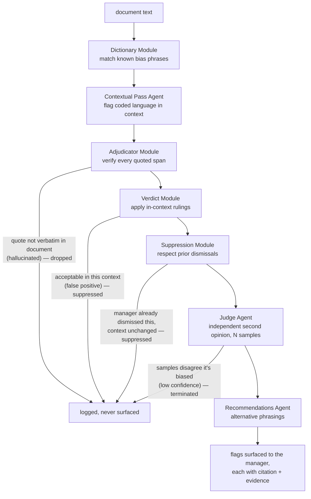
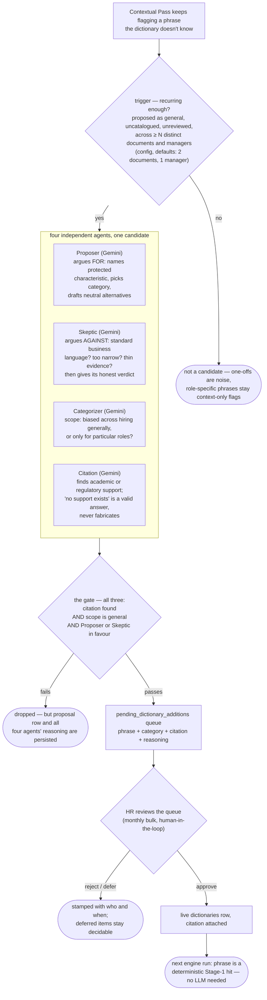

# Pattern Specular

A longitudinal bias-pattern analysis tool for managers: real-time bias flagging in hiring and promotion writing, drift checks against stated criteria, multi-jurisdiction statutory alignment, and statistically-gated pattern surfacing across a manager's full body of writing.

[](https://github.com/sm-daniyal/patternSpecular/actions/workflows/ci.yml)


[](LICENSE)

> **Documentation & Study Guide — [Master Roadmap & Interview Defense (docs/STUDY_GUIDE.md)](docs/STUDY_GUIDE.md).** The complete product walkthrough, user journeys, and research-grounded backend architecture.

Built solo by **sm-daniyal** — an applied-AI and full-stack enterprise platform delivered as an architectural evolution of *Pattern Mirror*.

---

## The problem

Unconscious bias persists in hiring decisions, despite the money firms spend on inclusivity training. Managers with hiring authority know the theory, but bias still creeps into the job descriptions, feedback, and promotion writeups they produce — and the tendency only shows across the whole body of writing over time, which no tool reviews.

Pattern Specular surfaces those patterns in a manager's own writing, with cited evidence — never as a hiring gate. Whether to act on what it shows stays the manager's decision.

## Product overview

Two portals over one analysis engine and one database: four views for managers, and an aggregate-only portal for HR.

**Manager portal — four views:**

- **JD Studio** — write job descriptions with live bias flagging: instant deterministic flags (<10ms), plus a streaming Gemini contextual pass that evaluates coded language and occupational context after a typing pause.
- **Feedback Checkpoint** — pre-submission check on interview feedback, plus drift against the original JD's stated criteria.
- **Promotion Writeup** — pre-submission check on a promotion case, plus drift against the employee's historical peer feedback.
- **Pattern Dashboard** — the longitudinal view: patterns across the manager's writing, surfaced only when statistically significant.

**HR portal — aggregates only, never individual content:**

- **Trends Dashboard** — firm-level bias trends; any aggregate covering fewer than three managers is suppressed ($k \ge 3$ anonymity), so no figure can identify an individual.
- **Dictionary Review** — the approval queue for proposed dictionary additions, each arriving with the reviewing agents' reasoning and citation.

**Design principles:**

- **Mirror, not judge.** The tool shows patterns to the manager; it never penalises.
- **Private by architecture.** Individual writing is visible only to the manager; HR sees aggregates only — enforced by the data model and API routes, not by policy.
- **Non-blocking.** Every flag is dismissible. The tool never prevents a submission.
- **Evidence for every flag.** Each observation cites statutory labor acts or peer-reviewed research.

**Not** a chatbot · **not** a training module · **not** a hiring gate.

---

## Technical design

### Multi-jurisdiction statutory engine

Pattern Specular evaluates writing across four statutory frameworks simultaneously:
1. **India (`IN`)**: *Code on Wages 2019*, *Rights of Persons with Disabilities (RPwD) Act 2016*, *Transgender Persons (Protection of Rights) Act 2019*.
2. **Singapore (`SG`)**: *TAFEP (Tripartite Alliance for Fair & Progressive Employment Practices)* guidelines.
3. **United States (`US`)**: *EEOC Title VII*, *Age Discrimination in Employment Act (ADEA)*.
4. **United Kingdom (`UK`)**: *Equality Act 2010*.

### Bias detection pipeline

A bounded flow orchestrated as an explicit state graph — every stage logged, every transition traceable, every flag span-verified. A flag reaches the manager only by surviving every gate; the stage name links to its code.

| Stage | Implementation | What it does |
|---|---|---|
| [Dictionary](backend/src/pattern_specular/engine/dictionary.py) | `engine/dictionary.py` | Deterministic, lemma-aware matching against curated, citation-backed statutory lexicons. No LLM call, sub-millisecond execution. |
| [Contextual Pass](backend/src/pattern_specular/engine/contextual_pass.py) | `engine/contextual_pass.py` | Schema-enforced Google Gemini call: catches coded, non-literal language not yet in the dictionary, and judges whether each phrase is a bona-fide occupational requirement (GDOR) or biased in context. |
| [Adjudicator](backend/src/pattern_specular/engine/adjudicator.py) | `engine/adjudicator.py` | Deterministic span verification: any LLM-claimed quote absent verbatim from the source is dropped. Hallucinated flags cannot reach the manager. |
| [Verdict](backend/src/pattern_specular/engine/verdict.py) | `engine/verdict.py` | Evaluates in-context statutory rulings and suppresses bona-fide occupational justifications. |
| [Suppression](backend/src/pattern_specular/engine/suppression.py) | `engine/suppression.py` | Filters out flags previously dismissed by the manager using sentence-level fingerprint hashes. |
| [Judge](backend/src/pattern_specular/engine/judge.py) | `engine/judge.py` | Multi-sample consensus confidence gate: verifies surviving flags against calibrated rubrics; low-confidence flags terminate here. |
| [Recommendations](backend/src/pattern_specular/engine/recommendations.py) | `engine/recommendations.py` | Two to three evidence-anchored alternative phrasings, only for flags above the confidence threshold. |

<details>
<summary>Diagram — the bias-detection pipeline</summary>



</details>

### Dictionary growth — the detector improves as it's used

A self-growing fast path: phrases the Contextual Pass keeps flagging across documents become candidates, four agents (Proposer, Skeptic, Categorizer, Citation) debate each, and HR approves what goes live. Nothing enters the dictionary without a citation, a general (not role-specific) scope, and a human sign-off — so wider adoption sharpens detection instead of leaving HR to hand-seed new terms each week. Full design: [docs/architecture/dictionary-growth.md](docs/architecture/dictionary-growth.md).

<details>
<summary>Diagram — the dictionary growth loop</summary>



</details>

### Drift check

The same engine run against a reference the writing should match: interview feedback against the JD's stated criteria, a promotion case against the employee's peer feedback. It reports which criteria the writing covered — each backed by a verified verbatim quote — and which it missed.

### Pattern surfacing

Aggregated queries over the manager's flag history, no LLM involved. A tendency is called a pattern only when Fisher's exact test says it is statistically significant ($p < 0.05$), not merely frequent.

---

## Tech stack

| Layer | Choices |
|---|---|
| Frontend | React 19 + TypeScript, Vite, Tailwind CSS v4, TipTap (editor surfaces), TanStack Router + Query |
| Backend | Python 3.12, FastAPI, SSE streaming, LangGraph, structlog |
| AI / agents | Google Gemini (`gemini-2.5-flash` / `gemini-3.5-flash-lite`); Instructor for structured outputs; LangGraph orchestration |
| Data | Neon Serverless PostgreSQL 16 (cloud pooled), SQLAlchemy 2.x, Alembic migrations; document text in Postgres, resume binaries in blob storage |
| Statistics | scipy — Fisher's exact test gating pattern surfacing |
| Quality gates | ruff, mypy --strict, eslint + prettier, pytest (240 unit/integration tests) + vitest (251 frontend tests), GitHub Actions CI |

---

## Getting started

Prerequisites: Python 3.12, Node 20+, a free Google AI Studio API key, and Neon PostgreSQL database.

```powershell
# 1. Backend — http://localhost:8000
cd D:\pattern-specular\backend
.\venv\Scripts\Activate.ps1
pip install -e .
alembic upgrade head
python -m pattern_specular.jobs.seed_demo
uvicorn pattern_specular.main:create_app --factory --reload --port 8000

# 2. Frontend — http://localhost:5173 (in a second shell)
cd D:\pattern-specular\frontend
npm install
npm run dev
```

### Seed demo accounts:
- **HR Portal:** `teresa.lisbon@example.com` / Password: any non-empty text
- **Manager Portal:** `sm.daniyal@example.com` (or `patrick.jane@example.com`, `areesha.naaz@example.com`) / Password: any non-empty text

---

## Documentation

| Document | What it is |
|---|---|
| [`docs/STUDY_GUIDE.md`](docs/STUDY_GUIDE.md) | The master study roadmap, architecture logs, and interview prep |
| [`docs/DESIGN_SPEC.md`](docs/DESIGN_SPEC.md) | Product design specification and user journeys |
| [`docs/architecture/overview.md`](docs/architecture/overview.md) | Technical architecture and invariant boundaries |
| [`docs/architecture/data-model.md`](docs/architecture/data-model.md) | Relational schema, ER diagrams, and privacy models |
| [`docs/architecture/llm-judge.md`](docs/architecture/llm-judge.md) | The LLM-as-a-Judge design |
| [`docs/architecture/dictionary-growth.md`](docs/architecture/dictionary-growth.md) | The 4-agent autonomous dictionary growth loop |
| [`docs/architecture/pattern-significance.md`](docs/architecture/pattern-significance.md) | Statistical gating via Fisher's Exact Test |
| [`docs/CONVENTIONS.md`](docs/CONVENTIONS.md) | Engineering workflow, testing, git, project management |
| [`docs/CODE_STYLE.md`](docs/CODE_STYLE.md) | Language-level style rules for Python and TypeScript |
| [`docs/adr/`](docs/adr/) | Architecture decision records — what was decided, when, and why |

---

## Provenance & Attribution

Pattern Specular is an architectural evolution of **[Pattern Mirror](https://github.com/Bernice-Koh/pattern-mirror)**, originally designed by **Bernice Koh** under the MIT License.

Key architectural advancements in **Pattern Specular** (authored by **[sm-daniyal](https://github.com/sm-daniyal)**):
1. **Google Gemini Re-architecture**: Replaced Anthropic dependencies with Google Gemini (`gemini-2.5-flash` / `gemini-3.5-flash-lite`) via `google-genai` and `instructor`.
2. **Cloud-Native Database**: Deployed and configured serverless connection pooling on **Neon PostgreSQL 16**.
3. **Multi-Jurisdiction Expansion**: Incorporated statutory lexicons for **India** (*Code on Wages 2019*, *RPwD Act 2016*, *Transgender Persons Act 2019*), **United States** (*EEOC Title VII*, *ADEA*), and **United Kingdom** (*Equality Act 2010*) alongside Singapore (*TAFEP*).
4. **Modern Design System**: Rebuilt frontend styling with **Tailwind CSS v4** featuring the executive Rosewood palette, diamond prism branding, and persistent draft sessions.
