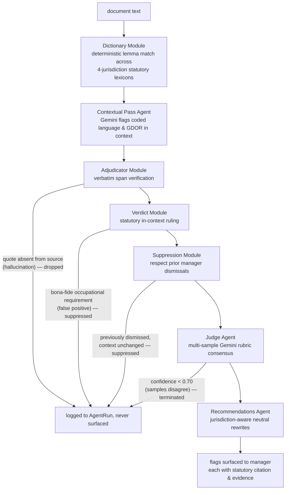
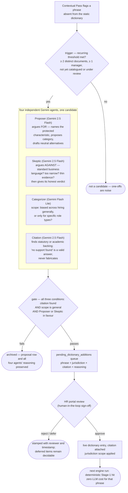

# Pattern Specular

A longitudinal bias-pattern analysis platform for hiring managers: real-time deterministic and agentic bias flagging in job descriptions, interview feedback, and promotion writing — with criteria drift evaluation, multi-jurisdiction statutory alignment, and statistically-gated pattern surfacing across a manager's full body of writing.

[](https://github.com/sm-daniyal/patternSpecular/actions/workflows/ci.yml)


[](LICENSE)

---

> 📊 **Explore the Deck & Live Demo:** A 17-slide visual executive walkthrough and product demo is available in [`docs/deck/pattern-specular-deck.pdf`](docs/deck/pattern-specular-deck.pdf). It covers the full 7-stage engine, manager writing surfaces, HR $k \ge 3$ trends, and 4-agent debate committee with lossless UI captures. Step-by-step interactive demo flow: [`docs/demo/DEMO_FLOW.md`](docs/demo/DEMO_FLOW.md).

---

## The problem

Bias in hiring and talent management persists in organisations that invest seriously in equity and inclusion. Managers with hiring and promotion authority understand the principles — yet coded language, gendered framing, and shifting evaluation criteria still appear in the documents they produce. A single flagged phrase in isolation is often ambiguous; the tendency only becomes clear across a manager's entire body of writing over time, which no standard tool reviews.

Pattern Specular surfaces those longitudinal patterns in a manager's own writing, grounded in statutory labor law and academic research — never as a hiring gate or a score. Whether to revise remains entirely the manager's decision.

## Product overview

Two isolated portals over one multi-jurisdiction analysis engine and one cloud database: four views for managers, and a strictly aggregated portal for HR.

**Manager portal — four views:**

- **JD Studio** — write job descriptions with live dual-layer bias detection: instant deterministic dictionary flags, plus a streaming contextual pass that evaluates coded language and genuine occupational requirements after a typing pause.
- **Feedback Checkpoint** — pre-submission evaluation of interview feedback, including a criteria drift check against the original job description's stated requirements.
- **Promotion Writeup** — pre-submission review of promotion nominations against level rubrics and historical peer feedback, with drift surfacing for uncovered criteria.
- **Pattern Dashboard** — the longitudinal view: aggregated writing tendencies surfaced only when Fisher's Exact Test confirms statistical significance across a manager's history.

**HR portal — aggregates only, never individual content:**

- **Trends Dashboard** — firm-level bias analytics; any data segment covering fewer than three managers is suppressed ($k \ge 3$ anonymity), so no figure can identify an individual.
- **Dictionary Review** — the human-in-the-loop approval queue for candidate bias terms surfaced autonomously by the four-agent debate loop.

**Design principles:**

- **Specular, not judicial.** The platform reflects patterns back to the manager for self-calibration; it never penalises or gates.
- **Private by architecture.** Individual writing is accessible only to the authoring manager; HR access is enforced at the schema and route levels, not by policy alone.
- **Non-blocking.** Every flag is dismissible. No submission or approval is ever gated by the platform.
- **Evidence for every flag.** Every surfaced observation cites statutory labor legislation or peer-reviewed research — no flag without a source.

**Not** a chatbot · **not** a training module · **not** a compliance checklist · **not** a hiring gate.

## Technical design

### Multi-jurisdiction statutory engine

Pattern Specular evaluates writing simultaneously against four statutory frameworks:

| Jurisdiction | Legislation covered |
|---|---|
| **India (IN)** | Code on Wages 2019 · Rights of Persons with Disabilities (RPwD) Act 2016 · Transgender Persons (Protection of Rights) Act 2019 |
| **Singapore (SG)** | TAFEP (Tripartite Alliance for Fair & Progressive Employment Practices) guidelines |
| **United States (US)** | EEOC Title VII · Age Discrimination in Employment Act (ADEA) |
| **United Kingdom (UK)** | Equality Act 2010 |

### Bias detection pipeline

A bounded flow orchestrated as an explicit LangGraph StateGraph — every stage logged, every transition traceable, every flag span-verified before it reaches the manager. A flag surfaces only by surviving every gate.

| Stage | What it does |
|---|---|
| [Dictionary](backend/src/pattern_specular/engine/dictionary.py) | Deterministic, lemma-aware spaCy matching against citation-backed multi-jurisdiction lexicons. Sub-millisecond, no LLM call. |
| [Contextual Pass](backend/src/pattern_specular/engine/contextual_pass.py) | Schema-enforced Gemini call via Instructor: catches coded, non-literal language absent from the dictionary and evaluates whether each phrase is a genuine occupational requirement (GDOR) or a bias signal. |
| [Adjudicator](backend/src/pattern_specular/engine/adjudicator.py) | Deterministic verbatim span verification: any LLM-claimed quote absent from the source document is dropped. Hallucinated flags cannot reach the manager. |
| [Verdict](backend/src/pattern_specular/engine/verdict.py) | Applies in-context statutory rulings: suppresses confirmed false positives that constitute bona-fide occupational requirements in context. |
| [Suppression](backend/src/pattern_specular/engine/suppression.py) | Partitions surviving flags against the manager's prior dismissals using sentence-level hashing. Previously dismissed flags in unchanged context are suppressed. |
| [Judge](backend/src/pattern_specular/engine/judge.py) | Multi-sample consensus gate: Gemini re-examines each surviving flag against a fixed rubric across N independent runs; confidence is the agreement fraction. Low-confidence flags terminate here. |
| [Recommendations](backend/src/pattern_specular/engine/recommendations.py) | Two to three evidence-anchored, jurisdiction-aware neutral rewrites for every confirmed flag. |

<details>
<summary>Diagram — the bias-detection pipeline</summary>



</details>

### Autonomous lexicon growth — the detector sharpens as it's used

Phrases the Contextual Pass flags repeatedly across documents, but which are absent from the static dictionary, are nominated as candidates. Four independent Gemini agents (Proposer, Skeptic, Categorizer, Citation) debate each candidate; the gate requires a verified citation, a general (not role-specific) scope, and inter-agent agreement. Candidates passing the gate enter an HR-reviewed approval queue before becoming live dictionary entries. Nothing enters the lexicon without a statutory or academic citation and a human sign-off. Full design: [architecture/dictionary-growth.md](docs/architecture/dictionary-growth.md).

<details>
<summary>Diagram — the autonomous lexicon growth loop</summary>



</details>

### Criteria drift check

The engine evaluated against a reference the writing is expected to cover: interview feedback checked against the original JD's stated criteria; a promotion nomination checked against the candidate's historical peer feedback. The system reports which criteria the writing addressed — each backed by a verified verbatim quote — and which were missed or under-evidenced.

### Statistical pattern surfacing

Aggregated queries over a manager's flag corpus, no LLM involved. A tendency is elevated to a pattern only when Fisher's Exact Test (`scipy.stats.fisher_exact`) confirms statistical significance against a peer baseline — not merely frequency.

## Tech stack

| Layer | Choices |
|---|---|
| Frontend | React 19 + TypeScript, Vite, Tailwind CSS v4, TipTap (ProseMirror), TanStack Router + Query |
| Backend | Python 3.12, FastAPI, SSE streaming, LangGraph orchestration, Pydantic v2, Structlog |
| AI / agents | Google Gemini — `gemini-2.5-flash` (analysis, recommendations, drift, debate agents), `gemini-3.5-flash-lite` (judge); `google-genai` + Instructor for schema enforcement |
| Data | Neon Serverless PostgreSQL 16 (SSL / pooled), SQLAlchemy 2.0 typed API, Alembic migrations |
| Statistics | scipy — Fisher's Exact Test gating pattern surfacing |
| Quality gates | ruff, mypy --strict, eslint, pytest (240 tests), vitest (251 tests), GitHub Actions CI |

## Getting started

Prerequisites: Python 3.12+, Node.js 20+, a Google AI Studio API key (`GOOGLE_API_KEY`), a Neon cloud PostgreSQL connection string (`DATABASE_URL`).

```powershell
# backend — http://localhost:8000
cd D:\pattern-specular\backend
python -m venv venv
.\venv\Scripts\Activate.ps1
pip install -e .

cp .env.example .env
# set DATABASE_URL and GOOGLE_API_KEY in .env

alembic upgrade head
python -m pattern_specular.jobs.seed_demo
uvicorn pattern_specular.main:create_app --factory --reload
```

```powershell
# frontend — http://localhost:5173, in a second terminal
cd D:\pattern-specular\frontend
npm install
npm run dev
```

Without a `GOOGLE_API_KEY` the deterministic stages still run — dictionary flags work; LLM stages pass through. Demo accounts and seed data details: [`docs/DESIGN_SPEC.md`](docs/DESIGN_SPEC.md).

## Repository layout

```
backend/    Python/FastAPI — engine, agents, API, services, jobs
frontend/   React/TS — manager portal and HR portal
docs/       Design spec, architecture docs, ADRs, conventions
```

## Documentation

| Document | What it is |
|---|---|
| [docs/](docs/README.md) | The full documentation index |
| [DESIGN_SPEC.md](docs/DESIGN_SPEC.md) | The product design specification |
| [pattern-specular-deck.pdf](docs/deck/pattern-specular-deck.pdf) | 17-slide executive walkthrough presentation deck (16:9 PDF) |
| [architecture/overview.md](docs/architecture/overview.md) | Overview of the technical architecture |
| [architecture/llm-judge.md](docs/architecture/llm-judge.md) | The LLM-as-a-Judge design |
| [compliance_frameworks.md](docs/references/compliance_frameworks.md) | Multi-jurisdiction statutory legal frameworks (India, SG, US, UK) |
| [adr/](docs/adr/) | Architecture decision records — what was decided, when, and why |
| [CONVENTIONS.md](docs/CONVENTIONS.md) | Engineering workflow, testing, git, project management |
| [CODE_STYLE.md](docs/CODE_STYLE.md) | Language-level style rules for Python and TypeScript |
| [CLAUDE.md](CLAUDE.md) | Collaboration rules for AI-assisted development on this repo |

The docs under [docs/architecture/](docs/architecture/overview.md) carry the rendered flow, sequence, and ER diagrams.

---

## Provenance & attribution

Pattern Specular is an architectural evolution of **[Pattern Mirror](https://github.com/Bernice-Koh/pattern-mirror)**, originally built by **Bernice Koh** under the MIT License.

---

Built by [sm-daniyal](https://github.com/sm-daniyal) — sovereign architectural extension of Pattern Mirror's original engine and product concept.
