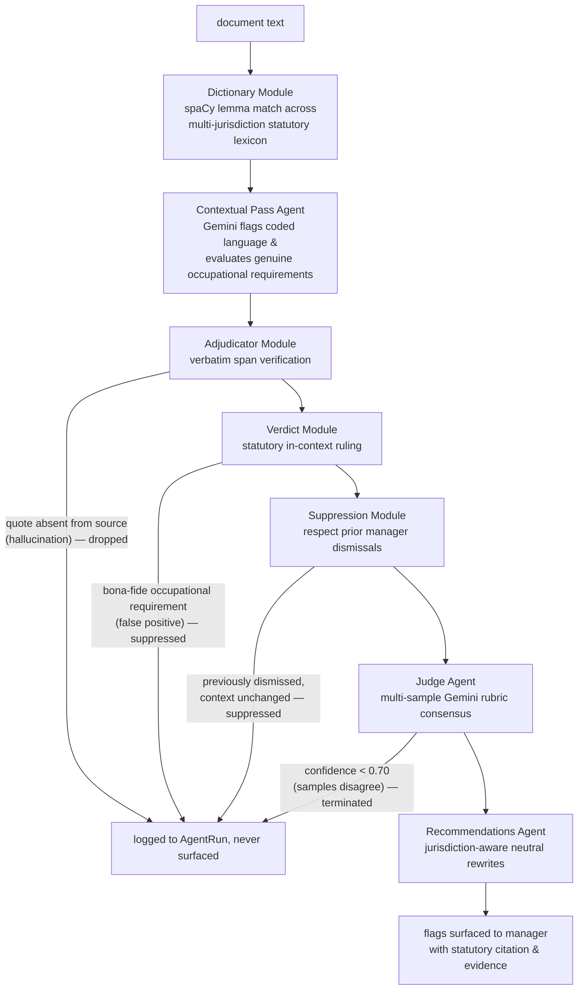
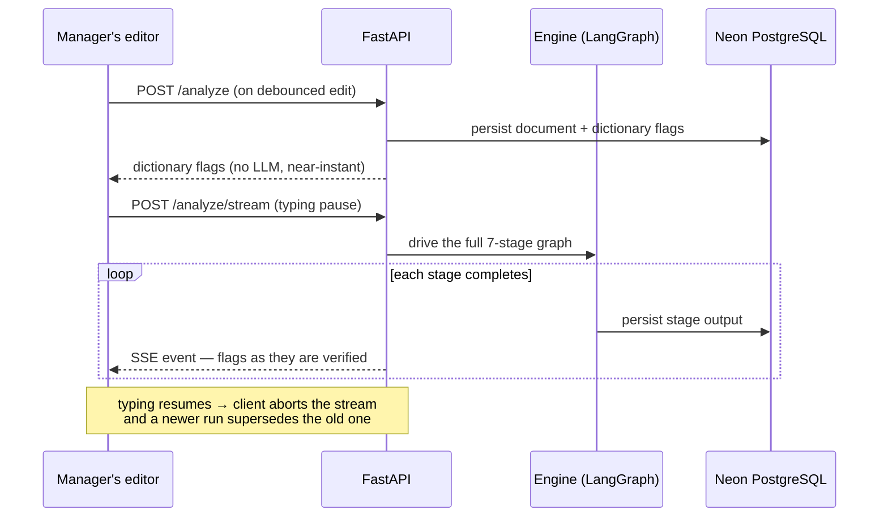
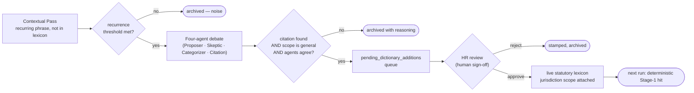

# Architecture overview

The system as built. For product intent see the [design spec](../DESIGN_SPEC.md); for
the decision history see the [ADRs](../adr/).

Pattern Specular analyses a manager's hiring and promotion writing for bias — live while
they type, and longitudinally across their full history. Everything below follows from
three commitments: managers must trust that their writing stays private, an LLM's claims
must be verified before a manager sees them, and a "pattern" must be a statistical
finding, not an impression.

## Shape

One FastAPI service, one React single-page app, one Neon Serverless PostgreSQL database.
The backend is a single installable package (`backend/src/pattern_specular/`) split by
purpose: `api/` routers stay thin, `services/` hold the business logic, `engine/` is
the analysis pipeline, `models/` + `db/` the persistence layer, `jobs/` the on-demand
entrypoints (demo seeding, dictionary growth review).

## The privacy boundary

**The promise: HR can never read an individual manager's writing — not a document, not
a title, not a per-manager statistic.** Managers only use a tool like this if the
analysis is theirs alone; the moment it feeds evaluation, they stop writing honestly in
it. So the platform gives HR firm-level insight (is the tool working? is the dictionary
healthy?) while making individual access structurally impossible, not merely forbidden:

- **HR sessions are cut off at the router.** Every HR-facing route lives under `/hr` and
  `/growth`, both wrapped by the `require_hr` role gate (`api/deps.py`); every
  manager-facing route resolves the signed-in user and filters queries by `owner_id`.
  An HR user asking for a manager's document does not get "access denied" — the route
  to ask that question simply does not exist for them.
- **The HR endpoints cannot leak what they never return.** Their response models carry
  only aggregate figures and labels — period, bias category, counts. No document id, no
  owner id, no text. Even a buggy query behind these routes could not expose a manager's
  writing, because the response schema has nowhere to put it.
- **Small aggregates are suppressed before they can identify anyone.** A firm-wide
  figure drawn from few enough managers *is* an individual disclosure. Any aggregate
  cell covering fewer than `hr_min_cell_size` (default 3) distinct managers is dropped
  (`services/hr_aggregates.py`). The $k \ge 3$ threshold is a configurable invariant,
  not a policy note.

The same boundary holds between managers: a document owned by someone else returns 404,
indistinguishable from a document that doesn't exist.

## The engine: trust nothing the LLM says

The analysis pipeline (`engine/orchestrator.py`) is a LangGraph StateGraph that
alternates LLM calls with deterministic code. The problem it must solve: an LLM can
fabricate — quote text that isn't in the document, or flag something defensible in
context. A manager who sees one fabricated flag stops trusting every flag. So the
pipeline is structured so that *Agents* (LLM calls) are always followed by *Modules*
(deterministic code) that verify their output, and a flag reaches the manager only by
surviving every gate in sequence:

What the structure buys:

- **A hallucinated quote cannot reach a manager.** The Adjudicator is deterministic
  code doing a verbatim string search — not a prompt asking the model to be honest.
  The drift check gets the same treatment: any LLM-claimed quote absent from the
  source is blanked before it is shown.
- **A second, independent model checks the first.** The Judge (`gemini-3.5-flash-lite`)
  re-examines each surviving flag against the raw document text — not against the
  Contextual Pass's explanation — so its verdict is independent of the reasoning it is
  auditing. It answers a fixed rubric N times; a flag's confidence is the agreement
  fraction. Full calibration design: [llm-judge.md](llm-judge.md).
- **Nothing is silently discarded.** Every dropped or suppressed flag is persisted with
  the reason — the audit trail is a product feature (log-everything, suppress-in-UI),
  and the Pattern Dashboard later mines these same rows.
- **The pipeline degrades, it doesn't fail.** Agents are injected via config. Without
  a `GOOGLE_API_KEY` the LLM stages become passthroughs and dictionary flagging still
  runs. Every LLM response is parsed through a schema (Instructor) before any domain
  object is built; every agent call's inputs, outputs, and token cost are recorded.

A **drift check** — same trust rules, different question — runs at the end of the graph
when a reference corpus is available: interview feedback is compared against the original
JD's confirmed criteria; promotion writeups are compared against the promotion rubric
for the target level. Each coverage claim is verbatim-verified against the source.

## The two data paths

**Live — while a manager types.** Bias feedback must arrive while the sentence is still
being written, but the full seven-stage pipeline takes seconds. Two triggers handle
this: a fast deterministic pass on every debounced keystroke, and the full engine only
after the manager pauses.

Persistence is per-stage and committed as the run progresses, so flags survive a
disconnect or an aborted stream — the flag log is product data, not a byproduct.

**Longitudinal — when a manager opens the Pattern Dashboard.** No LLM anywhere: the
Pattern Aggregator (`services/pattern_aggregator.py`) reads the persisted flag history,
builds a contingency table per candidate pattern, and surfaces only those passing
Fisher's Exact Test below the configured significance threshold
(`services/significance.py`; the full gating design: [pattern-significance.md](pattern-significance.md)).
A manager is never told "you have a pattern" on anecdote — a claim like *"coded terms
cluster in your JDs for technical roles"* surfaces only when the numbers rule out
coincidence. The dashboard also reflects the manager's own decisions back: each flag's
outcome (accepted, edited-around, dismissed-and-removed, dismissed-and-kept,
ignored-and-kept) is derived from the interaction log and the final submitted text
(`services/behavioural_states.py`).

HR's Trends Dashboard is a third read shape over the same rows — firm-wide,
aggregate-only, cell-suppressed as above.

## The lexicon growth path

When the Contextual Pass repeatedly flags a phrase that is absent from the static
dictionary, it enters the four-agent debate loop — four independent Gemini agents
(Proposer, Skeptic, Categorizer, Citation) evaluate the candidate and must agree before
it advances to HR review. Nothing enters the live statutory lexicon without a citation
and a human sign-off. Full design: [dictionary-growth.md](dictionary-growth.md).

## Persistence

- **Neon Serverless PostgreSQL 16** (SSL-required, pooled connections) holds everything
  queryable: documents (text inline), flags with full provenance (stage, rule, citation,
  jurisdiction, normalised span, sentence fingerprint, offsets), dismissals, interactions,
  drift findings, the statutory lexicon and its growth queue, agent runs, audit rows.
  The schema source of truth is the Alembic migration history, not the model classes.
  Current head: migration `0020_india_region_lexicon`.
- Dismissing a flag never deletes it — a dismissal is its own row, matched by a
  document-scoped signature, which is what lets the Suppression Module honour it and
  the Pattern Dashboard analyse it. How that identity works:
  [flags-and-suppression.md](flags-and-suppression.md).

## Configuration

Everything tunable lives in typed Pydantic settings (`core/config.py`), validated at
boot: model ids per agent, the Judge's confidence threshold and sample count, the
pattern significance threshold, the HR minimum cell size, growth recurrence floors.
Models are config, not code — swapping a Gemini model variant later requires no engine
change.
