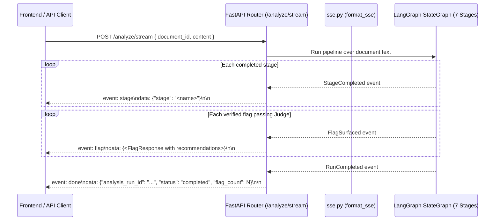

# Specification & Implementation Reconciliation (Drift Remediation)

* **Author:** sm-daniyal
* **Status:** Approved
* **Date:** 2026-11-10

--------------------------------------------------------------------------------

## Overview

Pattern Specular relies on strict documentation invariants to maintain defensibility in hiring and promotion evaluation. A recent audit identified divergences between the architecture documents and the codebase across API endpoint contracts, model allocations, database entity definitions, and engine prompts. This design document establishes a plan to reconcile these discrepancies so that documentation, runtime behavior, and developer contracts match.

## The Problem

When architecture documents diverge from the running codebase, three issues emerge:
1. **API Integration Mismatches**: Consumers or frontend modules referencing `api-contracts.md` encounter missing required fields (such as `expected_role` on `/auth/login` or `content` on `/analyze`) or expect SSE events (`run_started`, `recommendations`) that the server does not emit.
2. **Regulatory & Audit Inconsistencies**: The platform is positioned as a multi-jurisdiction evaluation engine (covering India, Singapore, United States, and United Kingdom), but the Stage 6 Judge prompt hardcodes Singapore's TAFEP framework. Furthermore, `statistical-proofs.md` cites a sample-size threshold ($n \ge 10$) that the implementation does not enforce.
3. **Internal Schema Blind Spots**: Core relational models (`PromotionRubricCriterion`, `CalibrationSample`, `CalibrationRun`) exist in active Alembic migrations but are omitted from the data model architecture diagrams, creating gaps in system comprehension.

## Goals

* Bring `docs/architecture/api-contracts.md` into exact alignment with `backend/src/pattern_specular/api/` schemas and SSE event streams.
* Update `docs/architecture/data-model.md` to accurately reflect all 20 active relational entities in the Neon PostgreSQL schema.
* Clarify model configuration defaults across `DESIGN_SPEC.md`, `core/config.py`, and `.env` (`gemini-3.5-flash-lite` operational tier vs `gemini-2.5-flash` evaluation tier).
* Generalize `backend/src/pattern_specular/engine/judge.py` prompt instructions and docstrings to align with multi-jurisdiction statutory coverage.
* Align `docs/architecture/flags-and-suppression.md` and `docs/architecture/statistical-proofs.md` with the underlying Python implementation logic.

## Non-Goals

* Rewriting the 7-stage engine orchestrator pipeline.
* Modifying database tables or executing new database migrations.
* Introducing new frontend surfaces or modifying React UI token structures.
* Altering the mathematical definition of Fisher's exact test in `services/significance.py`.

## Open Questions

* **Question 1**: Should `config.py` default models be promoted to `gemini-2.5-flash` to match `DESIGN_SPEC.md`, or should `DESIGN_SPEC.md` be updated to record `gemini-3.5-flash-lite` as the primary cost-effective operational model?
* **Question 2**: For the Stage 6 Judge prompt in `engine/judge.py`, should jurisdiction-specific statutory references be injected dynamically based on document context, or framed generally across the four supported labor standards?

## Critical User Journeys (CUJs)

### CUJ 1: API Consumer Connects to Live Analysis
* **Given**: A client application authenticated with a bearer token.
* **When**: The client submits a document via `POST /analyze/stream` with `document_id` and `content`.
* **Then**: The server opens an SSE connection and streams `event: stage` as pipeline nodes complete, `event: flag` with embedded rewrite recommendations as flags pass the Judge, and `event: done` with the terminal run status.

### CUJ 2: Compliance Auditor Verifies Statutory Engine
* **Given**: An auditor reviews the Stage 6 LLM Judge implementation for non-Singapore jurisdictions (e.g., India or UK).
* **When**: The auditor inspects `engine/judge.py` and the architecture specifications.
* **Then**: The system prompt instructs the Judge on multi-jurisdiction statutory principles (Code on Wages, RPwD Act, Title VII, Equality Act, TAFEP) without geographical bias.

## Technical Plan (Architecture)

### 1. API Contract Reconciliation (`docs/architecture/api-contracts.md`)
Update documentation to mirror Pydantic models in `backend/src/pattern_specular/api/`:
* `POST /auth/login`:
  - Request: `LoginRequest` (`email: str`, `password: str`, `expected_role: UserRole`).
  - Response: `LoginResponse` (`token: str`, `user: LoginUser { id, legal_name, initials, email, role }`).
* `POST /analyze`:
  - Request: `AnalyzeRequest` (`document_id: UUID`, `content: str`).
  - Response: `AnalyzeResponse` (`document_id: UUID`, `analysis_run_id: UUID`, `content_hash: str`, `flags: list[FlagResponse]`).
* `POST /analyze/stream`:
  - Request: `AnalyzeStreamRequest` (`document_id: UUID`, `content: str`).
  - Stream Framing: `event: stage` (`StageEventData`), `event: flag` (`FlagResponse`), `event: done` (`DoneEventData`).

### 2. Relational Schema Documentation Alignment (`docs/architecture/data-model.md`)
Update the entity relationship diagrams and specification tables to include:
* `PromotionRubricCriterion` (`promotion_rubric_criteria`): Represents promotion criteria for level benchmarks (`level_label`, `text`, `position`).
* `CalibrationSample` (`calibration_samples`): Benchmarking sample evaluating model predictions against gold-standard classifications.
* `CalibrationRun` (`calibration_runs`): Audit trail of historical calibration assessments across model iterations.

### 3. Engine Prompt & Docstring Corrections (`backend/src/pattern_specular/engine/judge.py`)
* Update `_SYSTEM_PROMPT` in `judge.py` to reference statutory non-discrimination principles across the supported jurisdictions (India, Singapore, US, UK) rather than Singapore TAFEP alone.
* Correct the module docstring on line 1 from `"Stage 4 of the engine: the LLM Judge"` to `"Stage 6 of the engine: the LLM Judge"`.

### 4. Suppression & Statistical Rule Clarifications
* Update `docs/architecture/flags-and-suppression.md` to state that sentence boundaries are extracted via explicit `.!?` character scanning in `slice_sentence`, avoiding misunderstanding about spaCy dependency parsing.
* Update `docs/architecture/statistical-proofs.md` to clarify that `is_significant` evaluates $p < \text{threshold}$ directly without a hard minimum count gate, as Fisher's exact test inherently handles small sample sizes.

### 5. Multi-Tier Model Allocation in `DESIGN_SPEC.md`
* Document that `gemini-3.5-flash-lite` operates as the default operational model across all stages (`core/config.py`) to minimize token cost and latency, while `gemini-2.5-flash` serves as the high-depth evaluation and benchmark tier.

## Alternatives Considered

### Alternative 1: Hardcoding Model Upgrades to `gemini-2.5-flash` in `core/config.py`
* **Mechanism**: Replace `gemini-3.5-flash-lite` with `gemini-2.5-flash` as the default model string across all configuration entries in `core/config.py`.
* **Trade-offs**: Aligns code to earlier wording in `DESIGN_SPEC.md` without modifying documentation, but raises token costs and increases latency on typing pauses.
* **Decision**: Rejected by author: Running `gemini-2.5-flash` across all stages introduces higher end-to-end response latency during interactive debounce intervals in the editor without measurable quality improvement on deterministic JSON output extraction. Documenting `gemini-3.5-flash-lite` as the operational default while preserving `gemini-2.5-flash` for high-depth evaluation benchmarks maintains performance and cost targets.

### Alternative 2: Enforcing Strict Minimum Sample Gate ($n \ge 10$) in Python Engine
* **Mechanism**: Add an explicit check in `services/significance.py` requiring $(a + b + c + d) \ge 10$ before evaluating $p$-values.
* **Trade-offs**: Strictly adheres to the theoretical text in `docs/architecture/statistical-proofs.md`, but artificially suppresses early statistically valid signals.
* **Decision**: Rejected by author: Fisher's exact test computes exact hypergeometric distribution probabilities directly and inherently handles small sample sizes. Imposing an arbitrary cutoff of 10 observations delays surfacing legitimate high-confidence disparities for small teams. The documentation should be aligned to match the implementation.

### Alternative 3: Reverting API Request Signatures to Old Spec (`text` instead of `content`, removing `expected_role`)
* **Mechanism**: Modify FastAPI endpoint schemas to match the legacy `api-contracts.md` file by renaming `content` to `text` and removing `expected_role` from `/auth/login`.
* **Trade-offs**: Keeps legacy documentation unchanged, but breaks active frontend client integrations.
* **Decision**: Rejected by author: Changing backend endpoints to match outdated documentation would break active React 19 frontend components and fail the existing 295 passing Vitest tests. Updating `api-contracts.md` preserves runtime stability and brings contracts up to date.

## Detailed Implementation Plan

The remediation workflow consists of updating documentation files to match live runtime contracts and correcting the Stage 6 Judge prompt and docstring in the backend codebase.

### Affected Files and Modifications

1. `docs/architecture/api-contracts.md`
   * **Target File**: `docs/architecture/api-contracts.md`
   * **Changes**:
     - Update `POST /auth/login` schema:
       - Add required fields `password: str` and `expected_role: UserRole` ("manager" | "hr") to the request body.
       - Update response schema to return `token: str` and `user: { id: UUID, legal_name: str, initials: str, email: str, role: str }`.
     - Update `POST /analyze` schema:
       - Require `document_id: UUID` and `content: str` in the request body.
       - Remove `text` from request body specifications.
       - Document response structure including `analysis_run_id`, `content_hash`, and list of `flags`.
     - Update `POST /analyze/stream` specification:
       - Replace legacy event references (`run_started`, `recommendations`) with actual SSE events emitted by `backend/src/pattern_specular/api/sse.py`: `event: stage`, `event: flag` (which contains embedded recommendation objects), and `event: done`.
   * **Rationale**: Aligns API contract documentation with active FastAPI route signatures and client SSE consumption patterns in the React 19 frontend.

2. `docs/architecture/data-model.md`
   * **Target File**: `docs/architecture/data-model.md`
   * **Changes**:
     - Add `PromotionRubricCriterion` entity definition and Mermaid diagram node:
       - Table: `promotion_rubric_criteria`
       - Key fields: `id` (UUID), `level_label` (string), `text` (text), `position` (integer), `created_at` (datetime).
     - Add `CalibrationSample` entity definition and Mermaid diagram node:
       - Table: `calibration_samples`
       - Key fields: `id` (UUID), `source_text` (text), `target_category` (string), `gold_label` (string), `created_at` (datetime).
     - Add `CalibrationRun` entity definition and Mermaid diagram node:
       - Table: `calibration_runs`
       - Key fields: `id` (UUID), `model_name` (string), `accuracy` (float), `f1_score` (float), `completed_at` (datetime).
   * **Rationale**: Ensures the data model documentation covers all 20 active relational tables managed by Alembic migrations in the PostgreSQL database.

3. `docs/architecture/flags-and-suppression.md`
   * **Target File**: `docs/architecture/flags-and-suppression.md`
   * **Changes**:
     - Clarify the sentence boundary extraction section to state that boundaries are identified using explicit `.!?` character scanning via `slice_sentence` in `backend/src/pattern_specular/engine/slice.py`.
     - Explicitly clarify that full spaCy dependency parsing is not executed for sentence segmentation in the real-time flagging pass.
   * **Rationale**: Eliminates developer confusion regarding the dependency structure of the real-time sentence slicing mechanism.

4. `docs/architecture/statistical-proofs.md`
   * **Target File**: `docs/architecture/statistical-proofs.md`
   * **Changes**:
     - Clarify that the significance function (`is_significant`) in `backend/src/pattern_specular/services/significance.py` evaluates $p < 0.05$ directly without enforcing an arbitrary $(a + b + c + d) \ge 10$ observation gate.
     - Note that Fisher's exact test inherently handles small sample sizes through hypergeometric distribution calculation.
   * **Rationale**: Reconciles the theoretical description with the actual implementation in `services/significance.py`.

5. `docs/DESIGN_SPEC.md`
   * **Target File**: `docs/DESIGN_SPEC.md`
   * **Changes**:
     - Document the model hierarchy: `gemini-3.5-flash-lite` serves as the primary default operational tier across all engine nodes (`core/config.py`), while `gemini-2.5-flash` is designated as the high-depth evaluation and benchmark tier.
     - Update latency and cost expectation tables to reflect the operational model tier.
   * **Rationale**: Resolves the discrepancy between the design specification and the configuration defaults in `core/config.py`.

6. `backend/src/pattern_specular/engine/judge.py`
   * **Target File**: `backend/src/pattern_specular/engine/judge.py`
   * **Changes**:
     - Correct the module docstring header from `"Stage 4 of the engine: the LLM Judge"` to `"Stage 6 of the engine: the LLM Judge"`.
     - Update `_SYSTEM_PROMPT` to reference statutory non-discrimination principles across the four supported jurisdictions (India, Singapore, US, UK) rather than Singapore's TAFEP framework alone.
   * **Rationale**: Fixes stage numbering inaccuracy in the engine pipeline and ensures the Judge prompt reflects the multi-jurisdiction scope of the platform.

### Verification Plan

1. **Backend Verification**:
   - Execute pytest across engine and API test suites:
     `.\venv\Scripts\python.exe -m pytest tests\engine tests\api`
   - Confirm all unit and integration tests pass without regression.
2. **Frontend Verification**:
   - Execute Vitest across client test suites:
     `npm test -- --run`
   - Confirm all 295 tests continue passing.
3. **Documentation Consistency Audit**:
   - Perform a cross-reference review to confirm that all updated schema fields and model names match their respective codebase definitions.
